  

  

  
  
  
  
  

  
  

---
About me
I'm a final-year B.E. Information Technology student at Chaitanya Bharathi Institute of Technology (CBIT) and a Software Engineer Intern at The Hartford India. I work at the intersection of AI research and software engineering—studying how intelligent systems reason, where they fail, and how they can be made more reliable, transparent, and useful.
My research interests include Trustworthy AI, LLM reasoning and evaluation, model reliability, fairness under distribution shift, AI safety, and multi-agent systems. I enjoy taking research questions beyond the paper: building systems, running experiments, evaluating failure modes, and turning useful ideas into working software.
Currently working with Java, Spring Boot, Angular, and TypeScript at The Hartford India.
Building MARS, a multi-agent platform for evidence-grounded academic research synthesis.
Previously contributed to SARAT workflows at INCOIS, supporting ocean-drift search-and-rescue analysis.
Outside technology: founding president of VMedha – Tech for Social Good, and an active Model United Nations participant.
At a glance

  
  
  
  

Selected work
MARS — Multi-Agent Reflective Synthesis
An AI-assisted research platform that coordinates specialized agents for query planning, academic retrieval, claim extraction, evidence verification, synthesis, and iterative reflection.
Combines FastAPI, React, RAG, ChromaDB, SQLite, and LLMs.
Designed around traceable claims, source-grounded evidence, and reflection-driven refinement.
Project evaluation reported a 40% reduction in hallucination rate across 50+ sessions.

  
  

SARAT — Search and Rescue Aid Tool
Contributed to SARAT v3 workflows during my project internship at the Indian National Centre for Ocean Information Services (INCOIS), Ministry of Earth Sciences.
Implemented adaptive seeding logic for ocean-drift simulations.
Developed GeoJSON outputs, interactive Leaflet visualizations, and automated PDF reports.
SARAT supports operational search-and-rescue workflows across 40+ countries.
Alzheimer's MRI Classification
Compared CNN architectures and transfer-learning approaches for multi-class Alzheimer's disease classification using 6,400 MRI scans.
A lightweight CNN achieved 98.3% test accuracy in the reported experiment.
ImageNet-pretrained ResNet18 achieved 40.41%, motivating an analysis of domain mismatch in transfer learning.
Research
My work explores reliable AI systems, reasoning evaluation, fairness, and model behaviour. The following are five selected papers from my research portfolio.
TRACER: A Dedicated Transparency, Reasoning Audit, and Compliance Evaluation Router for Trustworthy Transformer-Based AI Systems. — Accepted, IEEE 3rd International Conference on Advanced Computing Technologies (ICACT 2026). (First author)
Evaluating LLM Reasoning on String Rewriting Puzzles: Prompting Strategies, Metrics, and Human–AI Comparison. — Accepted, IEEE International Conference on AI and Security for Industrial IoT Systems (AI-SIIS 2026). (First author; code)
Fairness Under Distribution Shift: An Empirical Cross-Model Analysis on Tabular Benchmarks. — Accepted, IEEE 1st International Conference on Next-Gen Computing: Converging Microelectronics and Mechatronics for Transformative Solutions (ICCMM-26, 2026). (Second author)
Lightweight CNN Outperforms ImageNet-Pretrained ResNet18 for Multi-Class Alzheimer's Disease Classification: A Domain Mismatch Analysis. — Published in the proceedings of the 10th International Conference on Inventive Systems and Control (ICISC 2026). (First author)
A Comparative Study of Optimization Algorithms, Regularization Techniques, and CNN Architectures for CIFAR-10 Image Classification. — Published in the proceedings of the 4th International Conference on Sustainable Computing and Smart Systems (ICSCSS 2026). (Second author)
Experience
Role	Organisation	Focus
Software Engineer Intern · Jul 2026–Present	The Hartford India	Enterprise full-stack development with Java, Spring Boot, Angular, and TypeScript.
Project Intern · Apr 2026–Jul 2026	INCOIS · SARAT	Ocean-drift simulation post-processing, GeoJSON, Leaflet visualizations, and PDF automation.
AI/ML Research Intern · Jun 2025–Aug 2025	CBIT · Research under Prof. Dr. Ramakrishna Kolikipogu	OCR pipeline for handwritten medical prescriptions; benchmarked Tesseract, EasyOCR, and TrOCR on 129 prescriptions.
Leadership & recognition
Founding President, VMedha – Tech for Social Good, CBIT: founded and led a 45+ member student technical club.
Organising Lead, VIVE LE Tech Fest: helped deliver a state-level technical fest with 2,400+ registrations and 3,000+ students impacted.
Model United Nations: 10+ Best Delegate / Best Delegation awards; also served as a panelist and committee leader.
1st Prize, SUDHEE 2026: national-level technical paper presentation.
Academic Excellence: highest CGPA in class.
Tech stack

  

  

GitHub activity

  
  

  

Contribution snake

  <picture>
    <source media="(prefers-color-scheme: dark)" srcset="https://raw.githubusercontent.com/Mohammed-Abdul-Rafe-Sajid/Mohammed-Abdul-Rafe-Sajid/output/github-contribution-grid-snake-dark.svg" />
    <source media="(prefers-color-scheme: light)" srcset="https://raw.githubusercontent.com/Mohammed-Abdul-Rafe-Sajid/Mohammed-Abdul-Rafe-Sajid/output/github-contribution-grid-snake.svg" />
    
  </picture>

---

  <i>Curious about how intelligent systems work—and committed to making them more reliable.</i>
   
  <b>Open to research collaborations, meaningful engineering projects, and conversations about trustworthy AI.</b>

  <a href="https://mohammedabdulrafesajid.netlify.app/">Portfolio</a> ·
  <a href="https://www.linkedin.com/in/mohammed-abdul-rafe-sajid-49a716291/">LinkedIn</a> ·
  <a href="https://github.com/Mohammed-Abdul-Rafe-Sajid">GitHub</a> ·
  <a href="mailto:abdulrafesajid@gmail.com">Email</a>

